<h1 align="center">
  
</h1>

  

<h3 align="center">
  Full Stack Engineer | Agentic AI Engineer | AI Automation Developer
</h3>

 

🔭 Building **production-grade AI systems, intelligent agents & automation platforms**

🎓 Final Year B.Tech **Computer Science & AI** @ Newton School of Technology (2023–2027)

🤖 Working on **Agentic AI, AI Voice Agents, LLM Engineering & Intelligent Automation**

🚀 Experienced in building and shipping full-stack products, SaaS platforms, Chrome extensions and AI-powered applications.

🧠 Strong focus on **Full-Stack Architecture, DSA, System Design & Production Engineering**

💡 Interested in solving real-world problems through AI, automation and scalable software.

💬 Ask me about **Full Stack Development, RAG, AI Agents, Voice AI, LLMs, Cloud Architecture & System Design**

⚡ Fun fact: I love turning complex ideas into working products!

 

 
  
  
  

<h2 align="center">⚒️ Tech Stack & Tools ⚒️</h2>

### Languages

### Frontend Development

### Backend Development

### Cloud, Infrastructure & DevOps

### Tools & Platforms

 

<h3 align="center">🤖 AI / ML / Agentic Engineering</h3>

LLM Engineering • RAG Pipelines • AI Agents • Agentic Workflows • Voice AI • Retell AI • Prompt Engineering • Tool Calling • Knowledge Base Engineering • Vector Embeddings • Hugging Face • PyTorch • Computer Vision • OpenCV • Scikit-learn

 

<h3 align="center">🗄️ Databases & Data Engineering</h3>

PostgreSQL • MySQL • MongoDB • Firebase • Pinecone • Redis • Elasticsearch • Vector Databases

 

<h2 align="center">🚀 What I'm Currently Building & Exploring</h2>

✔ Production-ready AI Voice Agents and conversational systems

✔ Intelligent automation using LLMs, APIs and tool orchestration

✔ Multi-agent workflows and AI-powered business automation

✔ RAG pipelines and knowledge-grounded AI applications

✔ Scalable full-stack SaaS platforms and backend architectures

✔ AI evaluation, agent testing and production reliability

✔ Computer Vision and anomaly detection systems

✔ System Design, DSA and scalable distributed architectures

 

<h2 align="center">📊 GitHub Contribution Activity</h2>

<!-- Contribution Snake -->
<picture>
  <source media="(prefers-color-scheme: dark)" srcset="./dist/github-snake-dark.svg">
  <source media="(prefers-color-scheme: light)" srcset="./dist/github-snake.svg">
  
</picture>

  

<!-- GitHub Statistics -->

  

<!-- Profile Views -->

 

<h2 align="center">💼 Professional Experience</h2>

### Full Stack Engineer — Next Bharat Ventures
Production Applications • Full-Stack Development • AI Systems • Automation

### Full Stack Engineer — SayF
PeakAI • Chrome Extensions • SaaS Development • Product Engineering

### AI & Automation Engineering
Production Voice Agents • Retell AI • Agent Workflows • Knowledge Bases • AI Evaluation

 

<h2 align="center">🧠 My Engineering Interests</h2>

- Building software that solves real business problems.
- Designing scalable backend systems and distributed architectures.
- Making LLM applications reliable enough for production.
- Exploring agentic workflows and autonomous AI systems.
- Understanding systems deeply rather than just implementing features.

 

<h3 align="center">
  Always Building. Always Learning. Always Shipping. 🚀
</h3>

<h4 align="center">
  Let's build something impactful together!
</h4>
